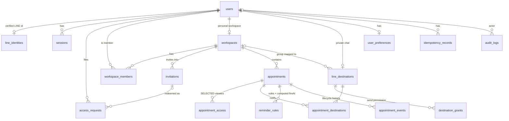

# EP02 — Database (MariaDB + Prisma)

## Decision

The owner changed the database from PostgreSQL to **MariaDB** before EP02 implementation
(2026-11-26). EP00/EP01 documents keep their historical wording; the master specification
carries an amendment note.

| Component                 | Version (pinned)               | Notes                                                      |
| ------------------------- | ------------------------------ | ---------------------------------------------------------- |
| `prisma` (CLI)            | 7.10.1                         | stable release                                             |
| `@prisma/client`          | 7.10.1                         | `prisma-client` generator, ESM, output git-ignored         |
| `@prisma/adapter-mariadb` | 7.10.1                         | MariaDB connector 3.5.4, pool per process                  |
| Connector                 | `mysql` provider               | MariaDB-compatible DDL only                                |
| Server                    | MariaDB Community, current LTS | existing local server; never installed/upgraded by scripts |

Use the existing lockfile. EP02.1 verified a clean `npm ci` and the complete tree with npm
11.21.3. The root Effect 3.22.1 override stays in effect. See the [remediation report](EP02.1-REMEDIATION-REPORT.md).

## Isolation

| Database               | Purpose               | Who may connect                                          |
| ---------------------- | --------------------- | -------------------------------------------------------- |
| `pdabliss_flow_dev`    | local development     | `flow_dev_app` (DML), `flow_dev_migrate` (ALL on db)     |
| `pdabliss_flow_test`   | automated tests       | `flow_test` (ALL on db) — the only database ever emptied |
| `pdabliss_flow_shadow` | Prisma drift check    | `flow_shadow` (ALL on db)                                |
| `pdabliss_flow`        | **future production** | not created, migrated or named by any EP02 script        |

All accounts are `@localhost` / `@127.0.0.1`, random 32-character passwords, no global
privileges (the setup script verifies this). Connection strings live only in
`%USERPROFILE%\.pdabliss\flow\dev.env` / `test.env` (outside Git and OneDrive, ACL: current
user). Nothing prints a URL, user name or password.

Guards (`apps/api/src/db/guard.ts`, mirrored in `scripts/db.mjs`) reject: production, any
unexpected database name (exact, case-sensitive), non-loopback hosts, query parameters or
fragments (ambiguous URLs), missing URLs, and cross-purpose use (runtime ↔ test). Destructive
operations (`tests-db` table reset) are allowed on `pdabliss_flow_test` only, after the live
connection reports `SELECT DATABASE() = pdabliss_flow_test` and every table is on the reset list.

The API verifies the connected database name and the UTC session (`@@session.time_zone =
'+00:00'`) at start-up and **refuses to start** otherwise. There is no in-memory fallback in the
server; `MemoryStore` exists only inside automated tests.

## Schema (19 tables, InnoDB, utf8mb4)

Stand-alone: `rate_limit_buckets` (HMAC key → count/window), `webhook_events` (LINE event id
dedupe, 7-day retention).

### Conventions

- IDs `CHAR(36)` UUIDs. Security-sensitive identifiers use **binary/case-sensitive** comparison:
  `line_identities.lineUserId`, `line_destinations.lineTargetId`, `webhook_events.eventId`,
  `idempotency_records.key` are `COLLATE utf8mb4_bin`; session keys, rate-limit keys and
  invitation token hashes are `BINARY(32)` (HMAC/SHA-256 — raw values are never stored).
- Text is `utf8mb4` (Thai + emoji, including ZWJ sequences); titles ≤ 120, notes ≤ 1000
  characters (validated in the shared zod schema).
- Instants: `DATETIME(3)`, always UTC (every pool connection runs `SET time_zone = '+00:00'`).
  Calendar dates (`startDate`, `endDate`, all-day appointments): `DATE`, mapped to/from
  `YYYY-MM-DD` strings without any time-zone arithmetic. Business time zone: `Asia/Bangkok`,
  computed in shared code, never from the OS time zone.
- MariaDB has no partial unique indexes, so "one open access request per user" uses a nullable
  unique column `openKey` (= userId while PENDING, NULL afterwards).
- Optimistic concurrency: `workspaces.version`, `appointments.version` (conditional
  `updateMany … WHERE version = ?`). Single-use operations (invitation redemption, request
  decisions, session end) are conditional updates — exactly one concurrent caller wins.
- Rate limits: `INSERT … ON DUPLICATE KEY UPDATE` (atomic). Webhook dedupe:
  `createMany(skipDuplicates)` on the event-id primary key.
- Referential actions: history-bearing rows are never cascaded away from users
  (`RESTRICT` on creators); child rows of an appointment cascade with it; appointments are
  **cancelled, never hard-deleted**.

### Fail-closed queries

Prisma drops filters whose value is `undefined` (`{ where: { userId: undefined } }` matches
every row). `PrismaStore` installs a query extension on every model operation
(`apps/api/src/store/fail-closed.ts`) that rejects any `where` containing an explicit
`undefined` anywhere (nested AND/OR/relations included). The visibility predicate additionally
refuses a missing viewer. Regression tests: `tests/fail-closed.test.ts` and the store contract
("fail-closed filters") on both stores.

## Migrations

- The initial migration is in `apps/api/prisma/migrations/20261126090000_ep02_init/`.
  `node scripts/db.mjs drift` runs the shadow replay and compares both guarded live databases
  with the Prisma schema and replay. It accepts the three known replay-only `JSON NULL`
  declarations when the complete SQL diff matches and MariaDB confirms `utf8mb4_bin LONGTEXT`,
  nullable defaults and the exact `JSON_VALID` check in development, test and shadow. The
  guard returns exit 2 for schema differences and exit 1 for execution failures.
- Apply: `node scripts/db.mjs deploy dev|test` (= `prisma migrate deploy`). `migrate dev`,
  `migrate reset` and `db push` are deliberately not offered. Drift is reported, never
  auto-reset; no data is deleted to make a migration pass.
- Future production (EP05): create `pdabliss_flow` + its own accounts, then `migrate deploy`
  with a production-purpose guard — not part of EP02.

## Owner migration (new workstation)

The EP01 owner lived in `%USERPROFILE%\.pdabliss\flow\access.json` on the office PC.

1. **Preferred:** copy that file (USB, not cloud) into the same folder on this PC, then
   `npm.cmd run admin -- import-ep01-owner` (idempotent: created / promoted / unchanged; refuses a
   second owner unless `--allow-additional-owner`). The file is backed up first.
2. **Otherwise:** open FLOW from LINE once (LINE verifies the identity server-side; FLOW stores a
   NEW account — do not submit an access request), then within 30 minutes
   `npm.cmd run admin -- recent-signins` → compare the masked LINE user ID with "Your user ID" in
   the LINE Developers console → `npm.cmd run admin -- bootstrap-owner <uuid> --confirm`. It refuses
   if any active owner exists. No public endpoint, no typed LINE id, no display-name matching.

## Retention

Ended sessions and expired rate-limit buckets are purged by the store (`purgeSessions`,
`purgeRateLimits`); webhook event ids after 7 days; idempotency records after 24 h. Raw webhook
bodies, ID tokens, cookies and invitation tokens are never stored. Appointments and their
history are kept (cancelled, not deleted); account deletion/export procedures are an EP05 item
for the owner's privacy policy.

## EP02 consolidated migration (`20261128090000_ep02_series_bills_colors`)

The migration is additive and applied to development and test databases on 2026-11-28. Dev row
counts were identical before and after (`.qa/ep02-consolidated/dev-counts-*.json`), and the
initial migration is byte-identical.

- New table `appointment_series`: rule, nullable `template JSON`, `generatedThrough`, status and
  version. It has foreign keys to `workspaces` and `users` (RESTRICT).
- `appointments` gains `kind` (EVENT/BILL), `seriesId` (FK RESTRICT), `occurrenceDate DATE`,
  `isException`, `amount DECIMAL(14,2)`, `currency CHAR(3)`, `paymentStatus`, `paidAt` and
  `paidByUserId`. **UNIQUE(`seriesId`, `occurrenceDate`)** prevents duplicate occurrences.
- `reminder_rules.status` gains `SUPPRESSED` (a paid bill occurrence).
  `appointment_events.type` gains `PAYMENT_CHANGED`.
- `workspace_members` gains `colorToken VARCHAR(16)`, a validated palette id per user and
  workspace.
- The semantic drift guard now lists four JSON columns, adding `appointment_series.template`,
  with the same exact whole-diff match and `JSON_VALID` / `utf8mb4_bin` / nullability
  verification. `node scripts/db.mjs sql` renders committed migrations against the schema
  through the shadow database only, to author reviewed migrations. It writes nothing.
- The test-database reset list includes `appointment_series`.
